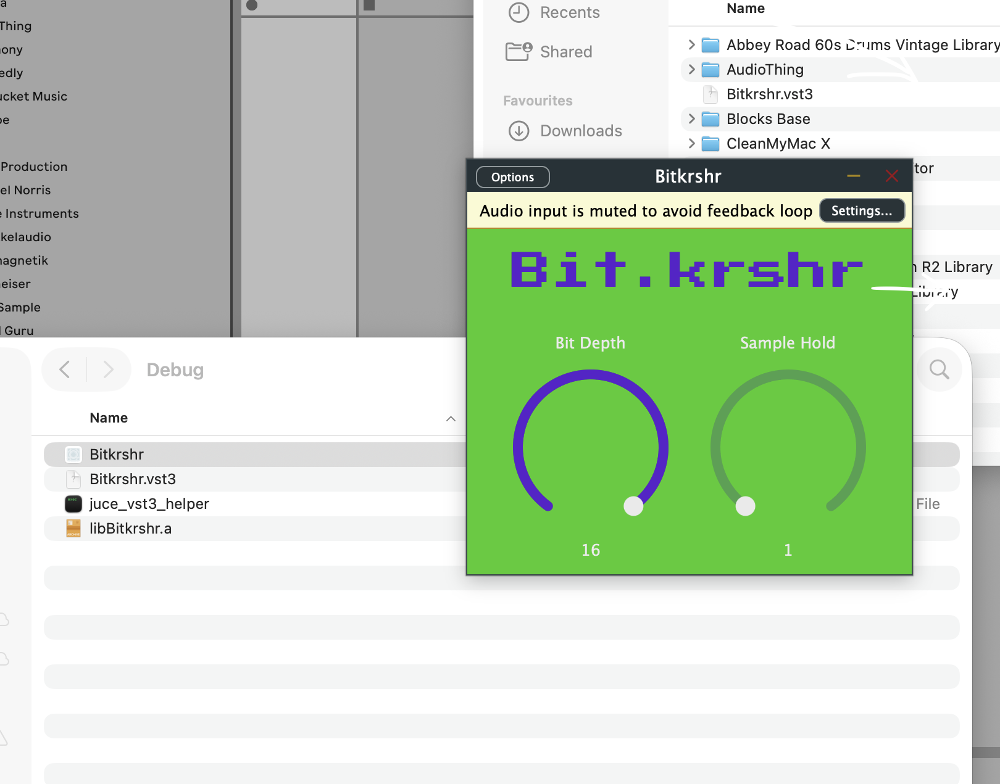

# Bit.krshr

A small bitcrusher effect plugin (C++, [JUCE](https://juce.com)), based on my DIY Bit.krshr guitar effect pedal.

I built the pedal first (Arduino Nano-compatible board, C++) and then ported the idea to a plugin. It was my first project with JUCE. I'm a beginner in audio programming, so the code is simple on purpose, and I'm happy about feedback.

> **Warning:** bit crushing can get loud. Turn your volume down before you start.




## Status

| What | Status |
|---|---|
| VST3, macOS | Tested in Ableton Live 12 |
| Standalone app | Not tested yet |
| Windows | Work in progress, no build yet |
| Other DAWs / formats (AU, AAX, LV2) | Not tested / not built |

<!-- ► Fill in: macOS version, Apple Silicon / Intel / universal. -->

## What it does

Bit.krshr reduces the sound quality on purpose, in two ways:

- **Bit reduction:** fewer bits per sample, so the signal gets rougher.
- **Sample-and-hold:** the signal is sampled less often, which adds aliasing and a lo-fi sound.

<!-- ► Replace with the real controls of your plugin, for example:
| Control | What it does | Range |
|---|---|---|
| Bits | ... | ... |
| Rate | ... | ... |
| Mix | ... | ... |
-->

## Install (macOS, VST3)

1. Download the latest release from the [portfolio page](https://erenkoc90.github.io/portfolio/) (or the Releases tab of this repository, if there is one).
2. Copy `Bitkrshr.vst3` to `/Library/Audio/Plug-Ins/VST3/` (all users) or `~/Library/Audio/Plug-Ins/VST3/` (only you).
3. Open your DAW and rescan your plugins.

The plugin is **not code-signed**, so macOS may block it the first time. You can allow it in *System Settings > Privacy & Security*. Advanced users can also remove the quarantine flag:

```
xattr -dr com.apple.quarantine /Library/Audio/Plug-Ins/VST3/Bitkrshr.vst3
```

Only install the plugin if you downloaded it from my portfolio page.

## Build from source

<!-- ► Replace this section with the steps you really use. The notes below are placeholders. -->

You need:

- a C++ compiler (Xcode command line tools on macOS)
- the [JUCE](https://juce.com) framework (not included in this repository)
- the VST3 SDK (included with JUCE)

JUCE is not part of this repository. Download it from juce.com, check its licence, and put it next to this project:

```
parent-folder/
  JUCE/          <- download from juce.com
  Bitkrshr/      <- this repository
```

Then build the project with the tool you use (► e.g. JuMake / CMake / Projucer), and write the exact commands here:

```
► your build commands
```

## Project structure

```
Source/
  PluginProcessor.cpp / .h   audio processing (bit reduction, sample-and-hold)
  PluginEditor.cpp / .h      user interface
```

<!-- ► Check the folder names and adjust. -->

## Related

- The pedal version (Arduino, C++): ► link to your pedal code or project page
- Portfolio: <https://erenkoc90.github.io/portfolio/>

## Licence

► Choose a licence for **your own code** and add a `LICENSE` file. If you have no preference, MIT is a common and simple choice. Then replace this paragraph with one line, for example: "My code is licensed under the MIT licence (see `LICENSE`)."

The plugin is provided "as is", without warranty of any kind. Use it at your own risk.

Third-party software and fonts are listed in [`THIRD-PARTY.txt`](THIRD-PARTY.txt). Their licence texts are in the [`licenses`](licenses) folder.

VST is a trademark of Steinberg Media Technologies GmbH. Ableton Live is a trademark of Ableton AG. They are named here only to describe what the plugin was tested with; there is no connection to or endorsement by the owners.

## About

Made by [Eren Koç](https://erenkoc90.github.io/portfolio/), Berlin. I'm a medical doctor retraining as a software developer (Fachinformatiker für Anwendungsentwicklung, IHK).
