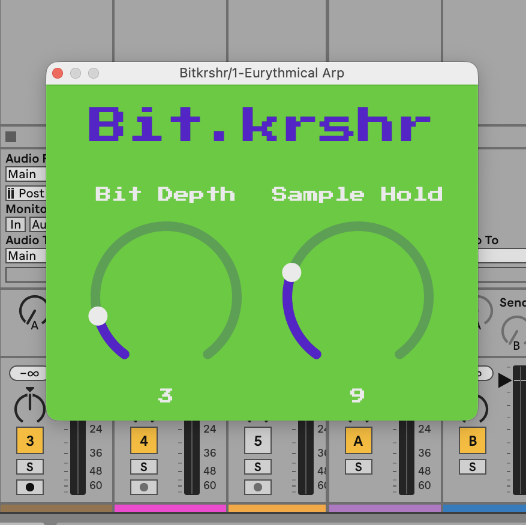

# Bit.krshr

A small bitcrusher effect plugin (C++, [JUCE](https://juce.com)), based on my DIY Bit.krshr guitar effect pedal.

I built the pedal first (Arduino Nano-compatible board, C++) and then ported the idea to a plugin. It was my first project with JUCE. I'm a beginner in audio programming, so the code is simple on purpose, and I'm happy about feedback.



> **Warning:** bit crushing can get loud. Turn your volume down before you start.

## Status

| What | Status |
|---|---|
| VST3, macOS (Apple Silicon, arm64) | Tested in Ableton Live 12, with a known issue (see below) |
| Standalone app | Not tested yet |
| macOS Intel | No build yet |
| Windows | Work in progress, no build yet |
| Other formats (AU, AAX, LV2) | Not tested / not built |

## Known issues

- **No output on some audio tracks in Ableton Live 12.** When I put the plugin on an audio track with my guitar as input, I got no output, even though there was input signal. It works on the Main channel and on a MIDI track. I have not found the cause yet. I suspect the channel/bus layout of the plugin and I'm investigating.

If you have an idea or see the same thing in another DAW, please open an issue.

## Next steps

1. Fix the known issue above (audio tracks).
2. Test and document the standalone app.
3. Build for Windows.
4. Build for macOS Intel (or a universal build).

## What it does

Bit.krshr reduces the sound quality on purpose, in two ways:

- **Bit reduction:** fewer bits per sample, so the signal gets rougher.
- **Sample-and-hold:** the signal is sampled less often, which adds aliasing and a lo-fi sound.

## Install (macOS, VST3)

1. Download the latest release from the Releases tab of this repository (or from my [portfolio page](https://erenkoc90.github.io/portfolio/)). The current build is for **Apple Silicon (arm64)** Macs only.
2. Unzip it and copy `Bitkrshr.vst3` to `/Library/Audio/Plug-Ins/VST3/` (all users) or `~/Library/Audio/Plug-Ins/VST3/` (only you).
3. Open your DAW and rescan your plugins.

The plugin is **not code-signed**, so macOS may block it the first time. You can allow it in *System Settings > Privacy & Security*. Advanced users can also remove the quarantine flag:

```
xattr -dr com.apple.quarantine ~/Library/Audio/Plug-Ins/VST3/Bitkrshr.vst3
```

(Use `/Library/Audio/Plug-Ins/VST3/Bitkrshr.vst3` if you installed it for all users.) Only install the plugin if you downloaded it from this repository or from my portfolio page.

## Build from source

You need:

- macOS with Xcode
- the [JUCE](https://juce.com) framework (not included in this repository; check its licence)

Steps:

1. Download JUCE from juce.com and build or open the **Projucer**.
2. Open `Bitkrshr.jucer` in the Projucer.
3. In the Projucer, set the **module paths** (and the JUCE modules path under *File > Global Paths*) to your own JUCE folder. The paths in the project file are from my computer.
4. Choose the *Xcode (macOS)* exporter and click *Save and Open in IDE*.
5. In Xcode, select the **Bit.krshr - VST3** scheme, set the configuration to **Release** (*Product > Scheme > Edit Scheme > Run > Build Configuration*), and build (Cmd+B).
6. The built plugin is in `Builds/MacOSX/build/Release/`. By default Xcode also copies it to `~/Library/Audio/Plug-Ins/VST3/`.

If the build fails with a sandbox or "Operation not permitted" error during code signing, set *User Script Sandboxing* to **No** in the Xcode build settings and do a clean build.

The `Builds/` folder is generated by the Projucer and is not part of this repository.

## Project structure

```
Source/
  PluginProcessor.cpp / .h   audio processing (bit reduction, sample-and-hold)
  PluginEditor.cpp / .h      user interface
Bitkrshr.jucer               Projucer project file
PressStart2P.ttf             pixel font used in the interface
licenses/                    licence texts of third-party components
THIRD-PARTY.txt              third-party notices
```

## Related

- Portfolio: <https://erenkoc90.github.io/portfolio/>

## Licence

My code is licensed under the MIT licence (see [`LICENSE`](LICENSE)).

The plugin is provided "as is", without warranty of any kind. Use it at your own risk.

Third-party software and fonts are listed in [`THIRD-PARTY.txt`](THIRD-PARTY.txt). Their licence texts are in the [`licenses`](licenses) folder. JUCE is not covered by the MIT licence of this repository; it has its own licence terms.

VST is a trademark of Steinberg Media Technologies GmbH. Ableton Live is a trademark of Ableton AG. They are named here only to describe what the plugin was tested with; there is no connection to or endorsement by the owners.

## About

Made by [Eren Koç](https://erenkoc90.github.io/portfolio/), Berlin. I'm a medical doctor retraining as a software developer (Fachinformatiker für Anwendungsentwicklung, IHK).
